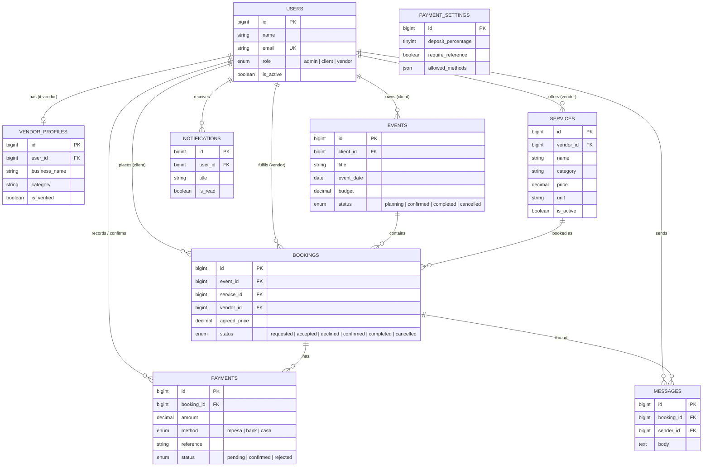
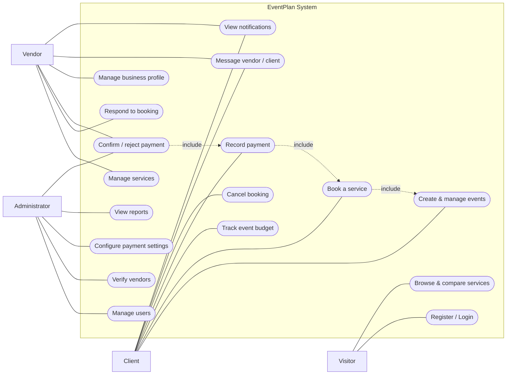

# EventPlan — System Documentation

**A Web-Based Event Planning and Service Booking Management System**

This document describes the design and workings of EventPlan: its architecture, roles, data
model (with ER diagram), use cases (with use-case diagram), API, and core workflows.

- Installation and the seeded login accounts: see **[INSTALLATION.md](INSTALLATION.md)**.
- Diagram source files for export: see **[docs/diagrams/](diagrams/)**.

---

## 1. Overview

EventPlan connects **clients** who are planning events (weddings, birthdays, corporate functions,
conferences, graduations) with **vendors** who provide event services (catering, decor,
photography, DJ, venue, florist, transport). Clients create an event, browse and compare services,
book them, track their budget, and record payments. Vendors manage their services and respond to
bookings. An administrator oversees users, verifies vendors, configures payment rules, and views
reports.

**Payments are made outside the system** (M-Pesa, bank transfer, cash). EventPlan does **not**
integrate a payment gateway; instead it **records and confirms** those offline payments.

---

## 2. Technology stack

| Layer | Technology |
|-------|------------|
| Frontend | Angular 19 (standalone components, signals) |
| Backend | Laravel 12 REST API (PHP 8.2) |
| Authentication | Laravel Sanctum (bearer tokens) |
| Database | MySQL / MariaDB (via XAMPP) |
| Styling | Hand-rolled CSS design system + inline SVG icons |

### Architecture

```
  Angular SPA (browser)  ──HTTP/JSON (bearer token)──►  Laravel REST API  ──►  MySQL
   components + services                                 controllers, models      tables
   http://localhost:4200                                 http://127.0.0.1:8000
```

The Angular app calls the Laravel API over HTTP. Every request carries a Sanctum bearer token
(attached by an HTTP interceptor). The API enforces authentication and **role-based access**
(a `role` middleware) on every protected route, so authorisation never depends on the UI.

---

## 3. User roles

| Role | Capabilities |
|------|--------------|
| **Visitor** (not logged in) | Browse and compare services; register; log in |
| **Client** | Create/manage events; book services; track budget; record payments; message vendors; cancel bookings; view notifications |
| **Vendor** | Manage services; accept/decline/complete bookings; confirm/reject payments; manage business profile; message clients |
| **Administrator** | Manage users (activate/deactivate); verify vendors; configure payment settings; view reports; confirm payments; see all bookings/payments |

---

## 4. Features mapped to the proposal

Every functional requirement from the project proposal (section 1.9) is implemented:

| Proposal requirement | Where it lives |
|----------------------|----------------|
| Register / authenticate users | Register & Login pages · Sanctum auth |
| Create and manage events | Events + Event Detail pages |
| Manage service-provider profiles | Vendor Profile page |
| Online service booking | Service Detail → Book; Bookings page |
| Manage bookings | Bookings page (role-aware actions) |
| Track event budgets | Event Detail budget summary |
| Send notifications | Notifications page + live unread badge |
| Generate reports | Admin dashboard / reports |
| Admin user management | Users & Vendors page |
| **Payments (record offline, no gateway)** | Record payment + Confirm/Reject + Payment Settings |

---

## 5. Data model

### 5.1 Entity Relationship Diagram

> Source: [`docs/diagrams/er-diagram.mmd`](diagrams/er-diagram.mmd). Paste into
> <https://mermaid.live> to export a PNG for your report.



### 5.2 Data dictionary (key tables)

**users** — every account. `role` is one of `admin`/`client`/`vendor`; `is_active` controls login.

**vendor_profiles** — one per vendor user; `is_verified` controls whether the vendor appears in
public listings.

**services** — what a vendor offers; `price` + `unit` (e.g. *per plate*, *per event*);
`is_active` hides it from browsing.

**events** — owned by a client; `budget` and `status` (auto-derived from its bookings).

**bookings** — links an event + a service + its vendor; `agreed_price` is the committed cost;
`status` follows the booking lifecycle.

**payments** — an offline payment recorded against a booking: `amount`, `method`, `reference`
(M-Pesa code / bank slip), `type` (deposit/balance/full), `status` (pending → confirmed/rejected).

**payment_settings** — a single configuration row: deposit %, allowed methods, who may confirm,
whether a reference is required, currency, receipt prefix, business details.

**messages** / **notifications** — per-booking messaging and per-user notifications.

---

## 6. Use case diagram

> Source: [`docs/diagrams/use-case.puml`](diagrams/use-case.puml) (PlantUML, proper UML) and
> [`docs/diagrams/use-case.mmd`](diagrams/use-case.mmd) (Mermaid). Export a PNG at
> <https://www.plantuml.com/plantuml> or <https://mermaid.live>.



---

## 7. Core workflows

### 7.1 Booking lifecycle
```
requested ─▶ accepted ─▶ confirmed ─▶ completed
    │            │
    └─ declined  └─ cancelled
```
- **Client** books a service → `requested` (goes to that service's vendor).
- **Vendor** accepts (`accepted`) or declines (`declined`).
- **Vendor** marks it `confirmed` (locked in), then `completed` after delivery.
- **Client** may cancel while `requested`/`accepted`.
- A `declined`/`cancelled`/`completed` booking is **terminal** — its status can't change, and no
  new payments can be recorded against it.

### 7.2 Payment (recorded offline, confirmed inside)
```
Client pays by M-Pesa/bank/cash (outside the system)
        │
        ▼
Record payment  → status: pending   (amount, method, reference, date, type)
        │
        ▼
Vendor/Admin verifies against real statement → Confirm → status: confirmed  → receipt issued
                                             └─ Reject  → status: rejected
```
Confirmed payments update the booking balance and the event's paid/outstanding totals.
Who may confirm, whether a reference is mandatory, the default deposit %, and allowed methods are
all set in **Payment Settings** (admin).

### 7.3 Event status (auto-derived from bookings)
| Active bookings under the event | Event status |
|---|---|
| any still requested/accepted | **planning** |
| all confirmed (or completed) | **confirmed** |
| all completed | **completed** |

Cancelled/declined bookings are ignored; a cancelled event is left unchanged.

---

## 8. API reference (summary)

Base URL: `http://127.0.0.1:8000/api`. All protected routes require
`Authorization: Bearer <token>`.

### Public
| Method | Endpoint | Purpose |
|--------|----------|---------|
| POST | `/register` | Register a client or vendor |
| POST | `/login` | Log in, returns a token |
| GET | `/services` | Browse services (filters: `search`, `category`, `max_price`, `sort`) |
| GET | `/services/{id}` | Service detail |
| GET | `/vendors` | Browse verified vendors |
| GET | `/options` | Configurable dropdown lists (categories, event types, units, methods) |

### Authenticated (all roles)
| Method | Endpoint | Purpose |
|--------|----------|---------|
| GET | `/me` | Current user |
| POST | `/logout` | Revoke token |
| GET | `/dashboard` | Role-aware dashboard metrics |
| GET | `/bookings` | Role-aware list of bookings |
| GET | `/bookings/{id}` | Booking detail (+ paid/balance) |
| PATCH | `/bookings/{id}/status` | Change booking status |
| GET/POST | `/bookings/{id}/messages` | Booking message thread |
| GET | `/payments` | Role-aware payments (filter `booking_id`) |
| POST | `/payments` | Record an offline payment |
| PATCH | `/payments/{id}/confirm` | Confirm a payment |
| PATCH | `/payments/{id}/reject` | Reject a payment |
| GET | `/payments/{id}/receipt` | Receipt payload |
| GET | `/payment-settings` | Read payment rules |
| GET | `/notifications` | List + unread count |
| PATCH | `/notifications/{id}/read`, `/notifications/read-all` | Mark read |

### Client
| Method | Endpoint | Purpose |
|--------|----------|---------|
| GET/POST/PUT/DELETE | `/events`, `/events/{id}` | Manage events |
| POST | `/bookings` | Book a service for an event |

### Vendor
| Method | Endpoint | Purpose |
|--------|----------|---------|
| GET/PUT | `/vendor/profile` | View/update business profile |
| GET/POST/PUT/DELETE | `/vendor/services`, `/vendor/services/{id}` | Manage services |

### Admin
| Method | Endpoint | Purpose |
|--------|----------|---------|
| GET | `/admin/users` | List/filter users |
| PATCH | `/admin/users/{id}/toggle` | Activate/deactivate |
| PATCH | `/admin/vendors/{id}/verify` | Verify/unverify vendor |
| GET | `/admin/reports` | Summary reports |
| PUT | `/admin/payment-settings` | Update payment rules |
| GET | `/admin/options` | List all options (including hidden) |
| POST | `/admin/options` | Add an option to a group |
| PUT | `/admin/options/{id}` | Rename / reorder an option |
| PATCH | `/admin/options/{id}/toggle` | Show / hide an option |
| DELETE | `/admin/options/{id}` | Delete an option |

---

## 9. Project structure
```
eventplan/
├── backend/
│   ├── app/Models/                    Eloquent models (User, Event, Booking, Payment, …)
│   ├── app/Http/Controllers/Api/      API controllers
│   ├── app/Http/Middleware/EnsureRole.php   role-based access control
│   ├── database/migrations/           schema
│   ├── database/seeders/              demo data + seeded logins
│   └── routes/api.php                 all API endpoints
├── frontend/
│   └── src/app/
│       ├── core/                      services, models, auth, interceptor, guards, notifications
│       ├── shared/                    icon component, confirm dialog
│       └── pages/                     all screens
└── docs/
    ├── INSTALLATION.md                step-by-step setup + seeded logins
    ├── SYSTEM-DOCUMENTATION.md        this file
    └── diagrams/                      ER + use-case diagram sources
```

---

## 10. Configuration & scalability

So EventPlan can adapt to different markets without code changes, the lists that used to be
hardcoded are now **admin-managed** from **Configuration** (`/admin/options`):

| Group | Used for | Example additions for another market |
|-------|----------|--------------------------------------|
| `service_category` | Service / vendor categories | Security, Tents, MC, Makeup |
| `event_type` | Event types | Baby Shower, Funeral, Product Launch |
| `service_unit` | How a service is priced | per person, per table, per km |
| `payment_method` | Offline payment methods | Airtel Money, Cheque, PayPal |

- Options can be **added, renamed, hidden** (retired without losing history) or **deleted**.
- Every dropdown in the app reads from these lists, so a change is reflected everywhere at once.
- **Payment methods** feed the allowed-methods choice in **Payment Settings**; the `payments.method`
  column is a free string, so new methods work end-to-end.
- Other market variables are already configurable in **Payment Settings**: currency, default
  deposit %, who confirms payments, whether a reference is required, and the business/paybill
  details shown to clients.

This keeps the system **variety- and market-agnostic**: the same codebase serves a wedding-only
business, a corporate-events agency, or a general multi-service marketplace by changing
configuration alone.

---

## 11. Security notes

- Passwords are hashed (bcrypt).
- API tokens via Laravel Sanctum; attached per request by an interceptor.
- Role-based authorisation enforced server-side on every protected route.
- Ownership checks: clients act only on their own events/bookings; vendors only on their own
  services/bookings; payments only by participants, confirmation only by the configured role.
- The offline-payment **confirmation step** prevents a client from marking an unpaid booking as
  paid — a vendor/admin must verify it against the real statement first.
